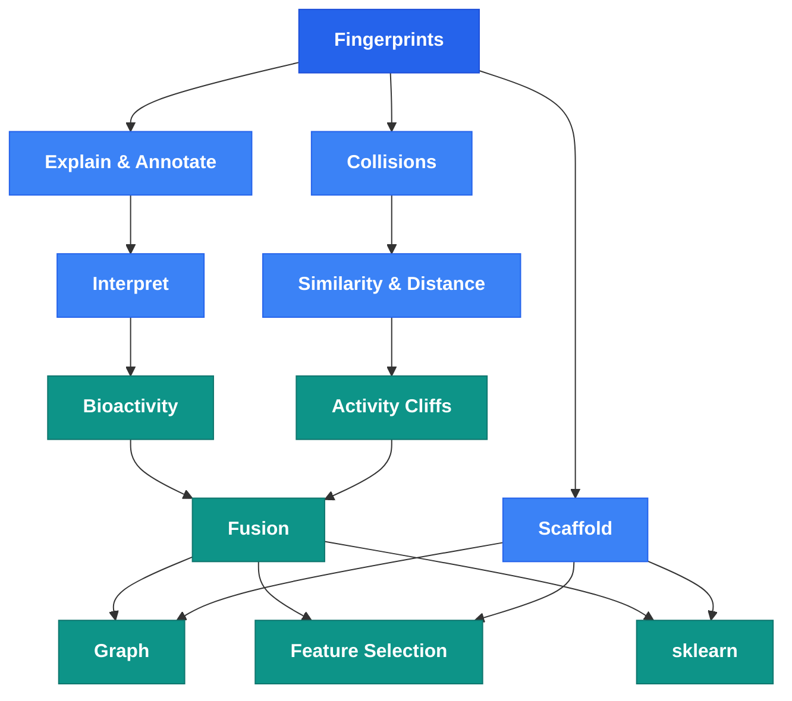

# API Reference

molfp is organized by activity type in a typical cheminformatics workflow. All functions are importable directly from `molfp`.

```python
import molfp
```

## Workflow

A cheminformatics project typically starts with computing molecular fingerprints, then moves through understanding what the bits mean, validating data quality, analyzing structure-activity relationships, and finally preparing features for machine learning. The diagram below shows how molfp's modules connect across these stages.

Each module handles one step — from [Fingerprints](#compute) through [Explain & Annotate](#understand), [Collisions](#validate), [Bioactivity](#analyze), [Fusion](#combine), and [Graph](#represent) representations, all the way to [sklearn](#model) transformers ready for pipelines. [Visualization and Standardize](#utilities) support the workflow at any stage.



Browse the modules below for function details and examples.

---

## Compute

### [Fingerprints](fingerprints.md)

Compute 30 molecular fingerprint types (13 2D + 9 3D + 8 graph). Every function accepts a single SMILES, a list, a pandas Series, or a DataFrame column.

```python
fp = molfp.maccs("CCO")
fps = molfp.ecfp4(["CCO", "c1ccccc1"], collision_free=True)
```

---

## Understand

### [Explain & Annotate](explain.md)

Bit-level explainability — which atoms set which bits, and what each bit means chemically.

```python
molfp.explain("CCO", "ecfp4")        # atom → bit mapping
molfp.annotate("maccs", 162)          # {"name": "Aromatic ring", ...}
```

### [Interpret](interpret.md)

SHAP-based feature importance with chemical meaning. Trains a classifier, computes SHAP values, and maps top bits back to substructures.

```python
result = molfp.interpret(smiles, activities, fp_type="ecfp4", collision_aware=True)
```

---

## Validate

### [Collisions](collisions.md)

Detect, remove, or avoid hash collisions in hashed fingerprints. Collision-free mode uses multi-hash Bloom filters.

```python
molfp.detect_collisions("c1ccccc1", "ecfp4", n_bits=1024)
fps = molfp.ecfp4(smiles, collision_free=True)
```

### [Similarity & Distance](similarity.md)

Five vectorized pairwise metrics (Tanimoto, Dice, Cosine, Sokal-Michener, Russel-Rao) and similarity profiling.

```python
molfp.tanimoto(fp_a, fp_b)
dist_matrix = molfp.pairwise(fps, metric="tanimoto")
```

---

## Analyze

### [Bioactivity](bioactivity.md)

Classify molecules by activity threshold and identify enriched/depleted bits that distinguish active from inactive.

```python
result = molfp.classify(smiles, activities, "ecfp4", threshold=6.0)
molfp.enriched_bits(smiles, activities, "maccs")
```

### [Activity Cliffs](cliffs.md)

Find structurally similar molecule pairs with large activity differences — the hard cases for QSAR.

```python
cliffs = molfp.activity_cliffs(smiles, activities, "ecfp4", sim_threshold=0.8)
```

---

## Combine

### [Fusion](fusion.md)

Build consensus fingerprints from multiple FP types. Selects the most informative bits across fingerprint families.

```python
result = molfp.fuse(smiles, activities, fp_types=["maccs", "ecfp4", "pubchem"])
```

### [Scaffold](scaffold.md)

Extract Murcko/generic scaffolds with chemical names from ~130 common ring systems. Scaffold-aware splitting prevents data leakage.

```python
molfp.scaffold("CC(=O)Oc1ccccc1C(=O)O")  # {"name": "Benzene", ...}
result = molfp.scaffold_split(smiles, test_size=0.2)
```

---

## Represent

### [Graph](graph.md)

Convert molecules to atom/bond feature matrices for GNNs. Four graph types (standard, distance, line, fragment) with optional enriched features. Includes PyG and DGL converters.

```python
g = molfp.mol_graph("c1ccccc1", type="standard", enriched=True)
X = molfp.graph_vectors(smiles, type="standard")
```

### [Feature Selection](selection.md)

Remove constant features and select top-k by mutual information — works with any fingerprint or graph vector output.

```python
result = molfp.select_features(X, y, k=500)
result = molfp.remove_low_variance(X, threshold=0.01)
```

---

## Model

### [sklearn](sklearn.md)

22 pipeline-ready transformers (one per FP type) plus `GraphTransformer`. Drop into any scikit-learn pipeline.

```python
from sklearn.pipeline import make_pipeline
from sklearn.ensemble import RandomForestClassifier
pipe = make_pipeline(molfp.ECFPTransformer(), RandomForestClassifier())
```

---

## Utilities

### [Visualization](viz.md)

2D molecule grids with fingerprint bit highlighting, and interactive 3D viewer with multiple styles.

```python
molfp.draw(smiles, highlight_bits=[88, 143], fp_type="maccs")
molfp.view3d("CCO", style="ball_and_stick")
```

### [Standardize](standardize.md)

SMILES cleaning pipeline — desalt, neutralize, canonicalize tautomers, deduplicate.

```python
clean = molfp.preprocess(smiles)  # full pipeline
molfp.standardize_smiles("CC(=O)Oc1ccccc1C(=O)[O-].[Na+]")
```
