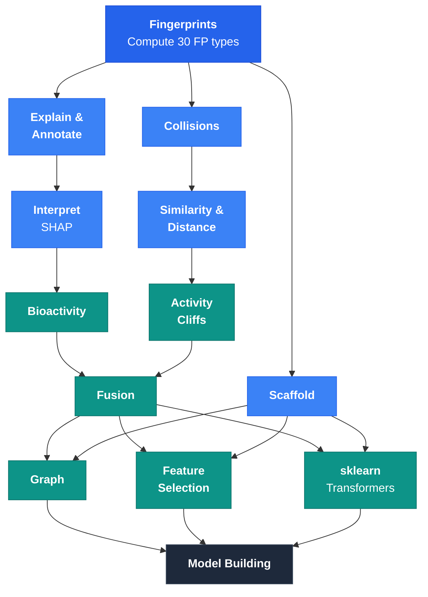

# API Reference

All functions are importable directly from `molfp`:

```python
import molfp
molfp.maccs("CCO")
```

## Module Overview

The sidebar modules are ordered by a typical cheminformatics workflow — from computing fingerprints through analysis to model building:



*Utilities not shown: [Visualization](viz.md) (2D/3D rendering) · [Standardize](standardize.md) (SMILES cleaning)*

| Stage | Modules | Purpose |
|-------|---------|---------|
| **Compute** | Fingerprints | Generate 30 molecular fingerprint types |
| **Understand** | Explain & Annotate, Interpret | Bit-level attribution, SHAP with chemical meaning |
| **Validate** | Collisions, Similarity & Distance | Hash collision handling, pairwise metrics |
| **Analyze** | Bioactivity, Activity Cliffs | Enriched/depleted bits, structure-activity cliffs |
| **Combine** | Fusion, Scaffold | Consensus FPs, scaffold extraction and splitting |
| **Represent** | Graph, Feature Selection | GNN-ready graphs, variance/MI feature filtering |
| **Model** | sklearn | 22 pipeline-ready transformers + GraphTransformer |
| **Utilities** | Visualization, Standardize | 2D/3D rendering, SMILES cleaning and deduplication |
